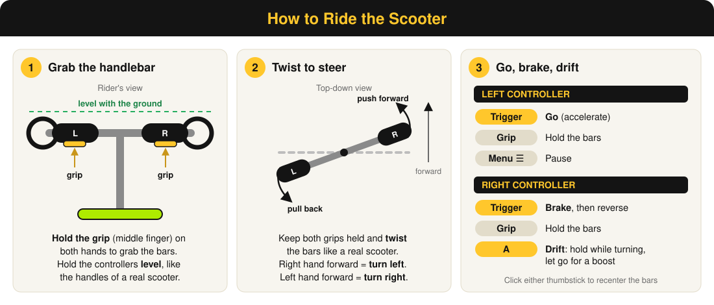

# CommodoreCircuit

**A Mario Kart-style VR racing game for Meta Quest, set on a lore-accurate version of Vanderbilt's campus.**

Players meet in a VR classroom, join a lobby with a code, and race scooters around campus together.

---

## Contents

- [Sprint Overview](#sprint-overview)
- [Developers/Roles](#developersroles)
- [Controls](#controls)
- [How to Test (latest build)](#how-to-test-latest-build)
- [Sprint 1](#sprint-1)
- [Sprint 2](#sprint-2)
- [Sprint 3 (due October 29)](#sprint-3-due-october-29)
- [Sprint 4 Plan](#sprint-4-plan)

## Sprint Overview

| Sprint   | Focus                                                          | Video                         | Build                     |
| -------- | -------------------------------------------------------------- | ----------------------------- | ------------------------- |
| Sprint 1 | Project setup, scooter prototype, design language              | [Sprint 1 video](https://drive.google.com/file/d/1OvjzkMCDrDujInlI412jbCorAFXqfw4g/view?usp=sharing)        | [Sprint1.apk](https://vanderbilt365-my.sharepoint.com/:u:/g/personal/knathifa_l_cambridge_vanderbilt_edu/IQD3QxGlTYyYSLAkvOZclbNsAQUnzUqWt1OGWfDIDUsNgjI?e=RBmTVM)       |
| Sprint 2 | Scooter driving, campus track, multiplayer lobby               | [Sprint 2 video](https://drive.google.com/file/d/1zbQ5yVL8Acbf7EDj6khqVg-LF22HKVvM/view?usp=sharing)        | [Sprint2.apk](https://vanderbilt365-my.sharepoint.com/:u:/g/personal/knathifa_l_cambridge_vanderbilt_edu/IQCcZSu9Oj8_TJ8FN54l0i2mAZUfM2zG1rn8rijY87jUv6s?e=LtUo2T)       |
| Sprint 3 | Full race loop, multiplayer race, Alumni Lawn track, new lobby | _Sprint 3 video (coming soon)_ | [Sprint3.apk](https://vanderbilt365-my.sharepoint.com/:f:/g/personal/knathifa_l_cambridge_vanderbilt_edu/IgA9IiQ7uj5YSL_Xj5EwE2QCAfGBX40-DTcwQjQOiXzZqeY?e=32jeNv)       |
| Sprint 4 | Visible opponents, race fixes, diegetic HUD, map, music        | Planned                       | Planned                   |

---

## Developers/Roles

| Member             | Major(s)           | Skills                                        | Role                                             |
| ------------------ | ------------------ | --------------------------------------------- | ------------------------------------------------ |
| Ty Levine          | CMA, Econ, Spanish | Storyboarding, Adobe, writing, presentation   | Designing scenes, communications                 |
| Joshua Jung        | Music, CS          | Frontend, Backend, React, Node, Java, JS      | Networking, Backend development, Asset managing  |
| Grayson Smith      | CS, Math           | Frontend, Backend, React, Figma, JS/TS, Java  | Design Director                                  |
| Alex Pearle        | CS, Math           | Unity, Frontend, Backend, Python, C++         | Develop Game assets/physics, Backend development |
| Knathifa Cambridge | CS                 | C++, Python, Storyboarding, Debugging, HCI/UX | GitHub management, Asset development             |

---

## Controls

### How to Drive

1. **Grab the handlebar:** hold the **grip** button (middle finger) on **both** controllers. The scooter only responds while you're holding the bars.
2. **Hold the controllers level:** keep them horizontal to the ground, the way you'd hold the handles of a real scooter.
3. **Go:** pull the **left trigger**.
4. **Brake / reverse:** pull the **right trigger** to slow down. Keep holding it after you stop to back up.
5. **Steer:** keep both grips held and **twist** the bars. Push your right hand forward to turn left, or your left hand forward to turn right.
6. **Drift:** while turning, hold **A**. Let go for a speed boost.

If the handlebar ends up in the wrong spot, click either thumbstick to move it back to your hands.

### All Controls

| Input                                    | Action                                                        |
| ---------------------------------------- | ------------------------------------------------------------- |
| Grip on both hands                       | Grab the handlebar                                            |
| Twist the handlebar                      | Steer                                                         |
| Left trigger                             | Go                                                            |
| Right trigger                            | Brake, then reverse                                           |
| A (or X)                                 | Drift while turning (let go for a boost)                      |
| Click either thumbstick                  | Recenter the handlebar to your hands                          |
| Right stick up / down (while stopped)    | Raise or lower your rider height                              |
| Left menu button (☰)                     | Pause menu (left stick to move, A or right trigger to choose) |
| Right controller + trigger               | Point at and press buttons on the lobby chalkboard            |
| Keyboard W / S / A·D / Space / R / Esc   | Editor testing: go / brake / steer / drift / recenter / pause |

---

## How to Test (latest build)

1. Download the Sprint 3 APK: [Sprint3.apk](https://vanderbilt365-my.sharepoint.com/:f:/g/personal/knathifa_l_cambridge_vanderbilt_edu/IgA9IiQ7uj5YSL_Xj5EwE2QCAfGBX40-DTcwQjQOiXzZqeY?e=32jeNv) (Vanderbilt OneDrive)
2. Install it on a Quest with SideQuest or Meta Quest Developer Hub, or run `adb install Sprint3.apk`
3. Open **Commodore Circuit** from Unknown Sources in your Quest library
4. In the classroom, point the right controller at the chalkboard and pull the trigger on **Create Lobby**
5. On a second headset, choose **Join Lobby** and enter the 4-character code shown on the board. Both players appear in the classroom.
   For solo testing, set Minimum Players to 1 and the race starts after a short countdown.
6. When the lobby countdown ends, everyone loads into the race together. Wait for "Get ready" and 3-2-1, then race using the [controls](#controls).
7. Finish the laps to see the FINISH banner and standings. The game returns everyone to the lobby after the results.

---

## Sprint 1

[Sprint 1 video](https://drive.google.com/file/d/1OvjzkMCDrDujInlI412jbCorAFXqfw4g/view?usp=sharing) · [Sprint 1 APK](https://vanderbilt365-my.sharepoint.com/:u:/g/personal/knathifa_l_cambridge_vanderbilt_edu/IQD3QxGlTYyYSLAkvOZclbNsAQUnzUqWt1OGWfDIDUsNgjI?e=RBmTVM)

### Sprint 1 Goals

- Set up the Unity project for Meta Quest VR development
- Decide on the game's concept, art style, and team roles
- Build a first drivable scooter prototype in VR
- Create a design language so everyone's assets look consistent

### Sprint 1: What We Completed

#### Project Setup (Joshua, Knathifa, Grayson)

- Created the Unity project and GitHub repository with a branch per team member
- Added the XR modules and SDKs needed for Quest: OpenXR, XR Interaction Toolkit, and Android build support
- Wrote the README with the project goal, team members, skills, and roles

#### Scooter Prototype (Alex)

- First version of the scooter with **acceleration and drift physics**
- A VR rig so the player rides the scooter in first person
- A **test track** with walls, plus a "wall bump" that pushes the scooter back when it hits a wall

#### Design Language (Ty, Grayson, Knathifa)

- **Concept and style:** a cartoon arcade racer, a "theme-park version" of Vanderbilt's campus in bright daylight, inspired by Mario Kart, Overwatch,
  and Fall Guys
- **Logo and wordmark:** a primary logo, a clean version, wordmark-only and icon-only variants
- **Color palette and typography:** Vanderbilt black and a brighter gold that stands out in VR, plus environment colors (sky, lawn, campus brick, stone
  trim)
- **UI and HUD mockups:** a "Let's Race" button, lobby player counter, standings badges, finish banner, wrong-way sign, and winner badge
- **Scooter reference sheet** for the scooter model
- Everything is documented in [`Design/DESIGN_LANGUAGE_1.md`](Design/DESIGN_LANGUAGE_1.md)

#### Presentation (Ty)

- Edited and put together the Sprint 1 presentation video

### Sprint 1: Who Did What

| Member             | Sprint 1 Contributions                                                                       |
| ------------------ | -------------------------------------------------------------------------------------------- |
| Ty Levine          | Design language document and visual assets (logos, UI/HUD mockups); Sprint 1 video           |
| Joshua Jung        | XR modules and SDK setup; README with roles and project description; reviewed and merged PRs |
| Grayson Smith      | GitHub setup and initialization                                                              |
| Alex Pearle        | Scooter acceleration and drift physics, VR rig, test track and wall bump                     |
| Knathifa Cambridge | GitHub setup and initialization                                                              |

### Sprint 1: Challenges and How We Solved Them

- **Setting up VR for the first time:** getting OpenXR, the XR Interaction Toolkit, and Android build settings to work together took several tries. We
  committed the working setup so everyone starts from the same configuration.
- **Merging Unity projects:** merging branches brought in hundreds of project and settings files at once. We agreed to merge into `main` through pull
  requests and keep scene work on separate branches.
- **Keeping the art consistent:** with several people making assets, styles could drift apart. The design language document (and a shared AI prompt
  style for concept art) gives everyone the same reference.

### Sprint 1: Plan for Sprint 2

| Member             | Plan                                                                                               |
| ------------------ | -------------------------------------------------------------------------------------------------- |
| Alex Pearle        | Improve scooter driving: turning, handlebar steering, drift boost; start a Vanderbilt campus track |
| Joshua Jung        | Multiplayer networking and a lobby where players gather before a race                              |
| Grayson Smith      | Vanderbilt-specific assets: buildings, outdoor objects, characters                                 |
| Knathifa Cambridge | Vanderbilt-specific assets: buildings, outdoor objects, characters                                 |
| Ty Levine          | Photograph the real Vanderbilt route for track reference; Sprint 2 video                           |

---

## Sprint 2

[Sprint 2 video](https://drive.google.com/file/d/1zbQ5yVL8Acbf7EDj6khqVg-LF22HKVvM/view?usp=sharing) · [Sprint 2 APK](https://vanderbilt365-my.sharepoint.com/:u:/g/personal/knathifa_l_cambridge_vanderbilt_edu/IQCcZSu9Oj8_TJ8FN54l0i2mAZUfM2zG1rn8rijY87jUv6s?e=LtUo2T)

### Sprint 2 Goals

- Get the scooter to drive well in VR: acceleration, turning, and drifting
- Build a Vanderbilt campus race track that looks like the real campus
- Design Vanderbilt-specific assets: buildings, outdoor objects, and characters
- Add multiplayer: players join one lobby with a code
- Build the classroom lobby where players gather before a race
- Connect the lobby to the race track

### Sprint 2: What We Completed

#### Scooter Driving (Alex, Joshua)

- **Lemon scooter** model with acceleration, braking, and reverse
- **Turning:** steer with the left stick, or grab the handlebar with both grips and twist it like a real scooter. The scooter leans into turns.
- **Drift boost:** hold the right trigger in a turn to drift, then let go for a speed boost, with visual boost effects
- **Comfort / motion sickness:** the rider's view stays level while the scooter model leans, a comfort vignette narrows the view at speed, and players
  can recenter and adjust rider height

#### Vanderbilt Campus Track (Alex, Ty)

- First version of the campus race track with walls and track surfaces, built from the scooter test track
- **Reference photos:** Ty photographed the real Vanderbilt route so the track's layout, buildings, and landmarks match campus
- Grass terrain and nature assets along the track (Joshua)

#### Vanderbilt Assets (Knathifa, Grayson)

- **Buildings:** Vanderbilt-specific campus buildings to line the track (Alumni Hall, EBI Tower, McGill)
- **Outdoor objects:** campus props such as lamp posts, trees, trash cans, a Rand cookie, and a frisbee
- **Interactable characters:** squirrels and students that bring the campus to life and that players can interact with on the track

#### Multiplayer Networking (Joshua)

- Added **Photon Fusion** (shared mode) and **Photon Voice**, so players in the same lobby can talk
- **Lobby codes:** one player creates a lobby and gets a 4-character code; others type it in to join. Codes leave out I, L, O, 0, and 1 so they're easy
  to read aloud.
- Clear error messages for a wrong code, a full lobby, or a race that already started
- Each player's head and hands are synced as a networked avatar
- A shared countdown starts the race when enough players have joined (shorter if the lobby fills up)

#### Classroom Lobby (Joshua)

- A classroom where players wait before the race, with objects you can pick up and hand presence
- **Chalkboard menu:** Create Lobby / Join Lobby, a keypad for codes, the lobby code, a player count, and the countdown, drawn in a chalk-style font
- **Laser pointer UI:** point the right controller at the board and pull the trigger to press buttons (like the Quest dashboard). Buttons turn gold
  when pointed at. Pressing them with a finger also works.

#### Scene Transitions (Joshua)

- **Lobby → Campus Track:** when the countdown ends, everyone in the lobby loads the campus track together
- If players leave mid-race and only one is left, the room returns to the lobby
- **Solo test mode:** set Minimum Players to 1 to test the full Lobby → Race flow with one headset

#### Presentation & Project Setup (Ty, Grayson)

- **Sprint video:** Ty edited and put together the Sprint 2 presentation video
- Android/Quest build settings, Meta XR audio settings, and OpenXR configuration (Grayson)
- Reviewed and merged pull requests between team branches (Grayson)

### Sprint 2: Who Did What

| Member             | Sprint 2 Contributions                                                                                                                                   |
| ------------------ | -------------------------------------------------------------------------------------------------------------------------------------------------------- |
| Ty Levine          | Edited and assembled the presentation video; photographed the Vanderbilt track route as reference for the Unity campus                                   |
| Joshua Jung        | Networking (Fusion + Voice), lobby codes, classroom lobby, chalkboard/laser menu, Lobby → Campus transition, comfort/controller tuning, grass terrain    |
| Grayson Smith      | Designed Vanderbilt buildings, outdoor objects, and interactable characters (squirrels, students); Android/XR build configuration; PR reviews and merges |
| Alex Pearle        | Lemon scooter, drift boost, VR handlebar steering, Vanderbilt campus track                                                                               |
| Knathifa Cambridge | Designed Vanderbilt buildings, outdoor objects, and interactable characters (squirrels, students)                                                        |

### Sprint 2: Challenges and How We Solved Them

- **Motion sickness:** leaning the camera with the scooter made testers queasy. We keep the view level, let only the scooter model lean, and added a
  comfort vignette.
- **Merging scenes across branches:** Unity scene files conflict badly in git. We moved repeatable setup into Editor menu commands
  (`CommodoreCircuit/...`) so a scene can be rebuilt instead of hand-merged.
- **Joining the wrong lobby:** in Fusion's shared mode, a mistyped code quietly _creates_ an empty room. The creator now tags its room, and joining a
  room without that tag returns you to the menu with "No lobby with that code."
- **Testing multiplayer with one headset:** we added a solo test mode so one person can test the whole flow.
- **Making the track feel like Vanderbilt:** building from memory wasn't accurate enough, so we photographed the real route and designed assets from
  those photos.
- **Disconnected scenes:** our scenes used to be separate test scenes. The Lobby → Campus Track flow is now the main path, and older test scenes
  are being retired.

### Sprint 2: Known Limitations (at the end of Sprint 2)

- The race had no finish line yet, so it didn't end on its own (fixed in Sprint 3)
- Other players' avatars didn't appear on the campus track. Each player rode their own scooter. (Started in Sprint 3)

### Sprint 2: Plan for Sprint 3

| Member             | Plan                                                                                                       |
| ------------------ | ---------------------------------------------------------------------------------------------------------- |
| Grayson Smith      | Race HUD and rules: race position (1st, 2nd, ...), standings, lap counter, and other race-specific details |
| Alex Pearle        | Scooter collisions (with walls, objects, and other players) and further drift tuning                       |
| Joshua Jung        | Further motion sickness work, and AI bots that fill empty spots so every race is full                      |
| Knathifa Cambridge | More Vanderbilt-specific track details and assets                                                          |
| Ty Levine          | More Vanderbilt-specific track details; Sprint 3 presentation video                                        |

---

## Sprint 3 (due October 29)

_Sprint 3 video (coming soon)_ · [Sprint 3 APK](https://vanderbilt365-my.sharepoint.com/:f:/g/personal/knathifa_l_cambridge_vanderbilt_edu/IgA9IiQ7uj5YSL_Xj5EwE2QCAfGBX40-DTcwQjQOiXzZqeY?e=32jeNv)

### Sprint 3 Goals

- Turn the race into a real game: countdown, laps, timer, wrong-way warning, finish line, and standings
- Run the race in multiplayer so everyone shares one race clock and one scoreboard
- Let players see each other, first in the lobby and then on the track
- Rebuild the lobby as our real classroom
- Build a more accurate Vanderbilt track around Alumni Lawn with real buildings and barriers
- Keep reducing motion sickness

### Sprint 3: Goal Check

| Goal (from the Sprint 2 plan)                    | Status                                                                                |
| ------------------------------------------------ | ------------------------------------------------------------------------------------- |
| Race HUD, standings, lap counter (Grayson)       | ✅ Done: countdown, timer, laps, wrong way, FINISH banner, results board              |
| Further motion sickness work (Joshua)            | ✅ Done: controller changes and comfort vignette tuning                               |
| More Vanderbilt track details (Knathifa, Ty)     | ✅ Done: Alumni Lawn track with real buildings, barriers, and the Carmichael overhang |
| Scooter collisions with walls (Alex, Knathifa)   | ✅ Done: barrier walls the scooter bounces off, plus a scooter wall fix               |
| Players visible to each other in a race (Joshua) | 🟡 In progress: works in the lobby; scooters on the track still need fixing           |
| Sprint 3 video (Ty)                              | 🟡 In progress: recording gameplay for the Sprint 3 presentation                      |
| AI bots to fill empty spots (Joshua)             | ⏸️ Not started; we focused on getting real players racing first                       |
| Collisions with other players (Alex)             | ⏸️ Not started; depends on players being visible on the track                         |

### Sprint 3: What We Completed

#### Race Game Loop (Grayson, Joshua)

- **Race track and lap tracking:** laps are counted by distance along the track instead of a finish-line trigger, so driving backwards over the line
  can't earn extra laps, and the starting grid can sit behind the line without costing anyone a lap
- **Race HUD:** "Get ready" and a 3-2-1 countdown, a race timer, lap counter and lap times, and a **wrong-way** warning
- **Finish and results:** a FINISH banner when you cross the line, then a live standings board. Finished racers show their time, others show their lap,
  and anyone who runs out of time shows DNF. The winner gets a WINNER! badge. These use the HUD designs from the Sprint 1 design language.
- **After the race:** multiplayer races return everyone to the lobby after a countdown; solo races let you press A to race again
- A `RaceSystemsBuilder` Editor command adds the whole race setup to a scene, so it doesn't have to be hand-merged

#### Multiplayer Race (Joshua)

- **Lobby joining works:** players join with a code and see each other in the classroom
- **Shared race clock:** the host moves the race through each phase (waiting → countdown → racing → results) and every player's screen follows along.
  The race starts once every player reports ready.
- **Shared standings:** each player's laps and progress are sent over the network so everyone sees the same ranking
- **Other racers (first version):** each opponent is shown as a copy of the scooter with a simple rider in that player's color, which matches their
  row on the scoreboard. This still isn't showing reliably on the track (see [Known Issues](#sprint-3-known-issues)).
- Tuned the Photon network settings and the XR controls for joining from the classroom

#### Pause Menu (Joshua)

- The left controller's menu button opens a pause menu in front of the rider, in Vanderbilt gold
- Pausing freezes only your own scooter and race clock. In a multiplayer race, everyone else keeps riding.

#### New Classroom Lobby (Joshua)

- Rebuilt the lobby to match our real classroom, from photos and a floor plan: projection screen, lectern, TV, windows with roller shades, doors,
  whiteboards, and a blue accent wall
- Cleaned up old test scenes (`Lobby`, `MainScene`, `SampleScene`) and moved the main scenes into `Assets/Scenes`

#### Alumni Lawn Campus (Alex)

- Built a new **Alumni Lawn** scene from **OpenStreetMap** data: real building footprints, roads, footpaths, trees, lamp posts, and benches in their
  real positions
- Every piece is its own object, sorted into folders, so the team can move and replace things easily

#### Alumni Lawn Race Track (Knathifa, Joshua)

- **Race track** laid out on Alumni Lawn (Knathifa)
- **Barrier tool:** draw a line of barriers in the Scene view and build them with one click. Each one is a low visible barrier with a tall invisible wall
  on top so the scooter can't get over it. (Knathifa)
- **Carmichael overhang:** a drive-through tunnel cut into the building so the track passes under it, like on the real campus (Knathifa)
- **Campus model swap:** replaces the gray-box buildings, trees, and lamp posts with Knathifa's Blender models. Trees and lamp posts that land on the
  track are hidden. (Knathifa)
- **Scooter wall fix** so the scooter bounces off walls properly (Knathifa)
- Merged the campus track prototype into the Alumni Lawn track and added the scooter to the scene (Joshua)

#### Comfort (Joshua)

- Controller changes and a tuned comfort vignette to reduce motion sickness while riding

#### Art and Audio (Ty, Grayson, Knathifa)

- Art for the campus is coming along well, with campus models in Blender
- Ty is composing soundtracks for the game

### Sprint 3: Who Did What

| Member             | Sprint 3 Contributions                                                                                                                                     |
| ------------------ | ---------------------------------------------------------------------------------------------------------------------------------------------------------- |
| Ty Levine          | Game soundtracks (in progress); Sprint 3 video                                                                                                             |
| Joshua Jung        | Multiplayer race and shared standings, other racers' visuals, pause menu, new classroom lobby, network/XR tuning, comfort, merging the track and race code |
| Grayson Smith      | Race game loop: track and lap tracking, countdown, timer, lap and wrong-way HUD, finish banner, results board, networked race session                      |
| Alex Pearle        | Alumni Lawn scenery built from OpenStreetMap data                                                                                                          |
| Knathifa Cambridge | Alumni Lawn race track, barrier tool, Carmichael overhang, Blender campus models and model swap, scooter wall fix                                          |

### Sprint 3: Challenges and How We Solved Them

- **Merging the race code:** Grayson's race loop and Joshua's networking were built on separate branches. We merged them and tested the full flow
  until the timer, laps, wrong-way warning, and finish all worked together.
- **Two campus tracks:** we had the original campus track and a new, more accurate Alumni Lawn scene. We merged the track prototype into the
  Alumni Lawn scene so there's one main track going forward.
- **Accurate campus layout:** placing buildings by hand wasn't accurate, so we generated the scene from OpenStreetMap data and swapped in our own models
  on top of the real footprints.
- **Driving through a building:** the real route passes under Carmichael, so we wrote a tool that cuts a tunnel into the building mesh without
  changing the original model.
- **Seeing other players:** each player's scooter only exists on their own headset, and only the avatar is networked. We started showing opponents as a
  copy of the scooter that follows each player's networked position. This is our top fix for Sprint 4.

### Sprint 3: Known Issues

- Players can see each other in the lobby but **not on their scooters during the race** yet
- Players can **spawn on top of each other** at the start; the starting grid positions need to be spread out
- The **pause menu button** needs fixing
- Some racing bugs are still being fixed

---

## Sprint 4 Plan

### Sprint 4 Goals

- Make every racer visible on their scooter and fix the starting grid
- Fix the remaining race bugs and the pause menu
- Move the timer and lap count onto the scooter so the HUD is part of the world (diegetic)
- Add a campus map that shows where everyone is
- Add music to the game

| Member             | Sprint 4 Plan                                                                                                                                                      |
| ------------------ | ------------------------------------------------------------------------------------------------------------------------------------------------------------------ |
| Joshua Jung        | Show opponents on their scooters during the race; spread out the starting positions so no one spawns on top of each other; fix race bugs and the pause menu button |
| Knathifa Cambridge | Add a racing outline to Alex's updated campus scene                                                                                                                |
| Alex Pearle        | Move Grayson's timer, lap count, and other race info onto the scooter for a diegetic experience                                                                    |
| Grayson Smith      | Add a map that shows each player's position on campus. It may be non-diegetic at first; we'll decide as a team.                                                    |
| Ty Levine          | Upload soundtracks to the shared OneDrive and add music to the game; Sprint 4 video                                                                                |
